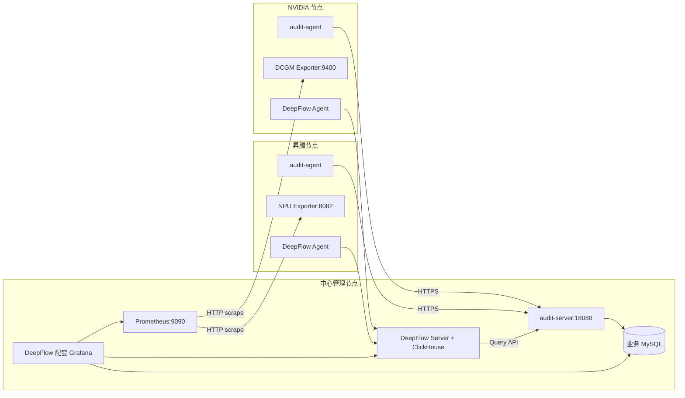

# 异构智算资源无侵入式审计系统 — 部署文档

> 版本：v1.0 | 日期：2026-11-24 | 适用环境：Linux 内网、在用 NVIDIA/昇腾智算服务器、Docker/systemd 业务服务。  
> 配套：[开发文档](compute-audit-development.md)。本文件是安装与验收操作手册，开源部分可按条件部署；audit-agent、audit-server 与专项 Dashboard 尚需按开发文档实现和构建，文中的自研命令、配置为交付契约，并非现成可下载程序。未在用户真实服务器上执行过这些命令。

## 1. 部署拓扑及选择

一期采用 DeepFlow CE 官方单机 Docker Compose 部署包（不要求现有智算节点使用 K8s）。复用其配套 Grafana、ClickHouse 和内部依赖。中心另外部署 Prometheus、独立 MySQL 审计库、audit-server。NVIDIA 节点运行 DeepFlow Agent、DCGM Exporter、audit-agent；昇腾节点运行 DeepFlow Agent、NPU Exporter、audit-agent。

DeepFlow 官方支持 Compose，但不推荐用于高并发/高可用生产，因为 Server 为单副本，ClickHouse 只能采用单分片。正式扩容优先采用官方 Helm/Kubernetes 方案，避免自行修改 DeepFlow 镜像与依赖。本期硬件指标保存在 Prometheus；不强制接入 DeepFlow Remote Write。



| 组件 | 中心节点 | NVIDIA 节点 | 昇腾节点 |
|---|---|---|---|
| DeepFlow Server/ClickHouse/Grafana | √ | — | — |
| DeepFlow Agent | 可选（中心监控） | √ | √ |
| DCGM Exporter | — | √ | — |
| NPU Exporter | — | — | √ |
| Prometheus、独立 MySQL | √ | — | — |
| 自研 audit-server | √ | — | — |
| 自研 audit-agent | — | √ | √ |

### 1.1 本机 Docker 开发

本机开发使用独立 `compute-audit-dev` Compose 项目。默认先启动 MySQL；`audit-db` 不发布宿主机端口，数据保存在本项目独立命名卷。不要连接、停止或重建现有 `smart-screen-mysql` 容器。`audit-server` 使用 `api` profile；服务端运行需要服务器证书和客户端 CA，Agent 上报时还需配置 CN 与 `host_id` 一致的客户端证书。

```powershell
Copy-Item .env.example .env
Copy-Item configs/server.example.yaml configs/server.yaml
# 编辑 .env 中的本地随机密码；把开发用证书放入 configs/tls/，不要提交私钥
docker compose -f compose.dev.yaml config --quiet
docker compose -f compose.dev.yaml up -d audit-db
docker compose --profile api -f compose.dev.yaml build audit-server
docker compose --profile api -f compose.dev.yaml run --rm --no-deps audit-server --mode migrate --config /etc/compute-audit/server.yaml
docker compose --profile api -f compose.dev.yaml run --rm --no-deps audit-server --mode register-host --config /etc/compute-audit/server.yaml --host-id gpu01 --hostname gpu01 --arch x86_64 --vendor nvidia
docker compose --profile api -f compose.dev.yaml run --rm --no-deps audit-server --mode register-host --config /etc/compute-audit/server.yaml --host-id npu01 --hostname npu01 --arch REPLACE_WITH_UNAME_M --vendor ascend
docker compose --profile api -f compose.dev.yaml up -d audit-server
```

如需让远端两台测试主机访问本机接收端，将 `AUDIT_SERVER_BIND_IP` 改为本机受控管理网 IP；默认只绑定回环地址。开发 Docker Desktop 当前约 7.6 GiB 内存，DeepFlow + ClickHouse 尚未纳入此轻量开发 Compose，不能据此推断完整中心栈已满足资源要求。

## 2. 环境准备与变更前检查

### 2.1 资源与版本

| 项目 | 建议 |
|---|---|
| 中心机 | PoC 建议 8 vCPU/16–32 GiB RAM、SSD 200 GiB 起；官方单机 DeepFlow 最低建议 4C8G，额外组件需要空间 |
| 开发联调规模 | NVIDIA 多卡服务器 1 台、昇腾 910B 服务器 1 台；初期仅接入少量测试/推理服务 |
| 本机 Docker Desktop | 已检查：v29.3.1，Linux x86_64，20 vCPU，约 7.6 GiB 可用内存；低于完整中心栈建议值，需分阶段启动并观察资源，或提高 Docker Desktop 内存上限 |
| 智算节点 | 不额外申请 GPU/NPU；采集依赖 CPU/内存及设备管理接口，实际开销必须压测 |
| 操作系统 | Linux x86_64/aarch64，按 DeepFlow Agent、驱动及 Exporter 支持矩阵确认 |
| 容器 | Docker Engine + Compose v2；昇腾优先采用厂商匹配的原生包，或官方容器部署方式 |
| 时钟 | 所有节点 NTP 同步，统一 UTC 存储；时钟偏差告警 |
| 版本管理 | DeepFlow Server/Agent/App 统一 v7.2.4；双 Exporter 与各自主机驱动兼容；正式部署固定精确版本和镜像 digest |

示例地址（全部替换为实际管理网地址）：中心 `10.10.0.10`，GPU 节点 `10.10.0.21`，昇腾节点 `10.10.0.22`。主机 ID 为 `gpu01`、`npu01`，与 IP 分离。安装前确认系统安全审批、维护窗口、镜像来源及回滚路径。

本机镜像检查结果（2026-11-24）：已缓存 `mysql:8.0.46`；DeepFlow、Prometheus、Grafana、ClickHouse、DCGM Exporter、NPU Exporter 尚未缓存。现有 `smart-screen-mysql` 正在运行，持久数据卷挂载到 `/var/lib/mysql`，并占用宿主机 3306；明确列为保护对象。严禁让审计程序连接该实例，或停止、重建、升级、迁移、改挂其数据卷/目录、删除其数据或执行全局卷清理。开发审计库使用独立容器和独立数据卷。

执行只读巡检：

```bash
hostnamectl
uname -a
uname -m
cat /etc/os-release
free -h
df -h
ip -br addr
ss -lntup
cat /proc/sys/kernel/random/boot_id
stat -fc %T /sys/fs/cgroup
systemctl --version
timedatectl status
docker version
docker compose version
```

GPU 节点执行：

```bash
nvidia-smi
nvidia-smi -L
nvidia-smi --query-compute-apps=gpu_uuid,pid,used_gpu_memory --format=csv
command -v nvidia-container-cli || true
```

昇腾节点执行：

```bash
npu-smi info
ls -l /dev/davinci* /dev/davinci_manager 2>/dev/null
ls -ld /usr/local/Ascend/driver 2>/dev/null
```

确认在实际推理工作期间存在设备 PID；记录驱动/固件、NPU 芯片与架构。不要因监控安装而直接升级现网驱动、重启 Docker 或模型服务。需要整改时另行申请维护窗口。检查 eBPF 内核能力及安全策略（如可用，`sudo bpftool feature probe kernel`），记录 DeepFlow 对应版本的支持情况；容器不能绕过宿主机内核不兼容。

### 2.2 网络访问矩阵

| 源 | 目的 | 端口 | 用途 |
|---|---|---|---|
| DeepFlow Agents | 中心 DeepFlow Server | 以官方部署包实际暴露控制/数据端口为准 | 注册、控制、数据上报；不要把 K8s NodePort 套用于 Compose |
| 中心 Prometheus | GPU 节点管理 IP | TCP 9400 | DCGM /metrics |
| 中心 Prometheus | 昇腾节点管理 IP | TCP 8082 | NPU /metrics（若使用本地代理，改为代理端口） |
| audit-agent | 中心 TLS 接收端 | TCP 18080（建议） | HTTPS 快照上报 |
| audit-server | DeepFlow SQL Query API | 按实际服务映射 | 内部查询 |
| Grafana | Prometheus / MySQL | 9090 / 3306（容器内部） | 数据源 |
| 授权运维人员 | Grafana | 3000 或反代 443 | 访问界面 |

仅对管理网络与指定源 IP 放行；数据库、DeepFlow 查询端口和 Exporter 不暴露公网。Docker published port 可能绕过部分防火墙前端规则，必须验证实际链路 ACL 或 DOCKER-USER/相应防火墙策略。自研接收端采用 TLS；管理端建议 HTTPS 反代。严禁关闭生产防火墙以解决连通问题。

## 3. 安装中心 DeepFlow

### 3.1 获取官方 Compose 包

在可联网中转环境下载，生产环境走审核与离线传输；下载包路径和版本变量来源于官方 All-in-One 文档。示例 LTS 系列 v7.0，具体补丁版本以实际部署包、官方 LTS 与兼容验证结果为准，不宣称为最新版本。

```bash
mkdir -p /opt/compute-audit/upstream
cd /opt/compute-audit/upstream
curl -fLO https://deepflow-ce.oss-cn-beijing.aliyuncs.com/pkg/docker-compose/latest/linux/deepflow-docker-compose.tar
sha256sum deepflow-docker-compose.tar > deepflow-docker-compose.tar.sha256
# 先检查归档成员，确认来源和路径安全
 tar -tf deepflow-docker-compose.tar | head -30
 tar -xf deepflow-docker-compose.tar
cd deepflow-docker-compose
cp .env .env.original
```

编辑 `.env`（不要清空其他官方配置项）：

```dotenv
DEEPFLOW_VERSION=v7.0
NODE_IP_FOR_DEEPFLOW=10.10.0.10
```

如官方包版本已更新，以包内变量与文档为准。先检查渲染后的服务、镜像、端口和持久卷；保存渲染清单时注意其中可能包含凭证。

```bash
docker compose -f docker-compose.yaml config --services
docker compose -f docker-compose.yaml config --images
docker compose -f docker-compose.yaml config --quiet
docker compose -f docker-compose.yaml pull
docker compose -f docker-compose.yaml up -d
docker compose -f docker-compose.yaml ps
docker compose -f docker-compose.yaml logs --tail=100
```

访问 `http://10.10.0.10:3000`（以实际端口为准）。官方包历史默认账号为 admin/deepflow；首次登录立即修改密码，限制管理网访问。检查 Grafana DeepFlow 数据源可用、ClickHouse 持久化正常。

### 3.2 配置传统服务器纳管

下载与 Server 同系列的 deepflow-ctl（离线可在中转机下载）。下例适用于文档中的 v7.0；以实际版本为准。

```bash
DF_SERIES=v7.0
ARCH=$(uname -m | sed 's/x86_64/amd64/;s/aarch64/arm64/')
curl -fLo /tmp/deepflow-ctl \
  "https://deepflow-ce.oss-cn-beijing.aliyuncs.com/bin/ctl/${DF_SERIES}/linux/${ARCH}/deepflow-ctl"
install -m 0755 /tmp/deepflow-ctl /usr/local/bin/deepflow-ctl
deepflow-ctl --help
```

按官方部署包实际 controller 地址和 ctl 参数连接；先确认 ctl 能查询 Server。以下为官方传统主机纳管命令形式，若版本不同以 `--help` 为准：

```bash
# 已存在时复用，不重复创建
printf 'name: legacy-host\ntype: agent_sync\n' | deepflow-ctl domain create -f -
deepflow-ctl agent-group create legacy-host
deepflow-ctl agent-group list legacy-host
```

保存返回的采集器组 ID，例如 `g-xxxxxxx`（不是实际 ID）。确认中心 controller `local_ip_ranges` 包含管理和业务网段；传统主机类型的配置项随版本变化，参考官方 legacy-host 文档，在 Compose 对应 Server 配置中修改，禁止把 Helm values 原样当作 Server YAML 使用。变更中心配置前备份。

在采集器组配置中启用 workload 资源同步、进程同步及 L7 观测。下列为较新 Agent 配置结构的片段，应合并进实际导出的配置，不覆盖其他默认规则；旧版本可能采用 `os-proc-sync-enabled` 等字段。开启前核验功能开关及 eBPF 权限。

```yaml
inputs:
  resources:
    workload_resource_sync_enabled: true
  proc:
    enabled: true
    process_matcher:
      - match_regex: '.*'
        enabled_features:
          - proc.gprocess_info
        only_in_container: false
```

使用 `deepflow-ctl agent-group-config --help`（若当前版本不同，查官方命令）或平台管理能力导出、校验并更新采集组配置。确认 L7 请求日志开启，PoC 流量采集不主动采样；检查限流、丢弃指标和 TLS 解析能力。不要为获得完整日志无条件提升现网流量采集上限。

## 4. 每台智算服务器安装 DeepFlow Agent

推荐宿主机 systemd 方式，便于获取宿主 PID 和运维。选择匹配实际发行版、CPU 架构与 Server 版本的 RPM/DEB/二进制包。以下给出官方二进制包路径示例。

```bash
DF_SERIES=v7.0
ARCH=$(uname -m | sed 's/x86_64/amd64/;s/aarch64/arm64/')
mkdir -p /opt/compute-audit/install
cd /opt/compute-audit/install
curl -fLO "https://deepflow-ce.oss-cn-beijing.aliyuncs.com/bin/agent/${DF_SERIES}/linux/${ARCH}/deepflow-agent.tar.gz"
tar -tzf deepflow-agent.tar.gz | head -30
# 解压到暂存目录，检查二进制和签名/校验后再安装
mkdir -p deepflow-agent-stage
tar -xzf deepflow-agent.tar.gz -C deepflow-agent-stage
find deepflow-agent-stage -type f -name deepflow-agent
# 使用上条命令找到的实际二进制路径安装至 /usr/sbin/deepflow-agent
```

创建 `/etc/deepflow-agent.yaml`（如已有 Agent，备份并复用，不能再部署第二个）：

```yaml
controller-ips:
  - 10.10.0.10
vtap-group-id-request: 'g-REPLACE_WITH_ACTUAL_ID'
```

将上面的组 ID 换为真实值。使用官方安装包提供的 unit 优先；只有二进制安装且没有现存 unit 时，才创建 `/etc/systemd/system/deepflow-agent.service`：

```ini
[Unit]
Description=DeepFlow Agent
After=network-online.target
Wants=network-online.target

[Service]
ExecStart=/usr/sbin/deepflow-agent
Restart=on-failure
RestartSec=10
LimitCORE=1G

[Install]
WantedBy=multi-user.target
```

```bash
systemctl daemon-reload
systemctl enable --now deepflow-agent
systemctl status deepflow-agent --no-pager
journalctl -u deepflow-agent -n 100 --no-pager
```

确认版本默认配置路径确为 `/etc/deepflow-agent.yaml`，否则按官方参数指定。eBPF 采集所需 root/capabilities 由安全审批决定。可选 Docker 运行方式需官方 host network、host PID、相关 capabilities 与必要挂载，不要直接采用不加限制的 `--privileged` 作为通用方案。

中心端检查该主机在线、主机标识、进程与请求日志；从另一台测试机调用已获准的 HTTP 模型接口，确认 `source_ip/path/server_pid` 等证据。若仅有连接数据没有 PID/HTTP Path，先排查采集配置与协议能力，不进入后续精确关联验收。

## 5. NVIDIA 节点安装 DCGM Exporter

官方镜像使用 NVIDIA Container Toolkit 暴露设备。已有 GPU 容器正常运行时，原则上复用其 runtime；如未安装 toolkit，不要未经评估修改现网 Docker 配置或重启 Docker。可按官方支持方式原生部署 Exporter。

```bash
# DCGM 4.6.1 与 Exporter 4.8.4 官方配套；旧驱动环境按支持矩阵向下适配并锁定配套版本
export DCGM_IMAGE=nvcr.io/nvidia/k8s/dcgm-exporter:4.6.1-4.8.4
export GPU_MGMT_IP=10.10.0.21
docker pull "$DCGM_IMAGE"
docker image inspect "$DCGM_IMAGE" --format '{{json .RepoDigests}}'
# 若已有同名容器，先检查并复用，不直接删除
 docker run -d --name dcgm-exporter --restart unless-stopped \
  --gpus all --cap-add SYS_ADMIN \
  -p "${GPU_MGMT_IP}:9400:9400" "$DCGM_IMAGE"
```

SYS_ADMIN 是官方示例中针对部分遥测能力的权限要求，生产应根据所需指标验证能否进一步收紧；已有 nv-hostengine 的系统应按 NVIDIA 文档选用连接现存 hostengine 的方式，避免冲突。镜像必须匹配 CPU 架构，GPU 设备不需要独占分配给 Exporter。

```bash
docker logs --tail=100 dcgm-exporter
curl -fsS "http://${GPU_MGMT_IP}:9400/metrics" | grep -E '^DCGM_FI_DEV_(GPU_UTIL|FB_USED|FB_FREE|GPU_TEMP|POWER_USAGE)' | head -20
nvidia-smi --query-compute-apps=gpu_uuid,pid,used_gpu_memory --format=csv,noheader,nounits
```

确认设备 UUID 和使用进程对应。DCGM 默认指标不足以支持普通 Docker/systemd 的完整 PID 映射，后续 audit-agent 执行宿主机 `nvidia-smi` 或 NVML。不能用 GPU 利用率替代 PID 证据。

## 6. 昇腾节点安装 NPU Exporter

官方仓库已提供二进制/systemd 与容器部署文档。为降低对现有业务容器的影响，一期优先使用与现网芯片/驱动/架构匹配的官方二进制包；若此方式无法提供宿主 PID，则在安全审批后采用官方特权容器方案并验收宿主 PID。

### 6.1 安装前准备

1. 在 [MindCluster 发布页](https://gitcode.com/Ascend/mind-cluster/releases) 或华为官方软件渠道获取对应 NPU Exporter 发行包；从 [官方安装说明](https://github.com/Ascend/mind-cluster/blob/master/docs/zh/scheduling/05_developer_guide/00_installation_deployment/00_manual_installation/03_npu_exporter.md) 确认所需用户、驱动访问、目录权限、二进制及配置文件。不要假定所有驱动和 310/910 型号支持相同指标。
2. 校验官方签名/校验和；解压到暂存目录，检查 `npu-exporter -version` 与包内说明。
3. 按锁定版本的官方步骤准备 hwMindX 用户、日志目录、驱动权限及二进制；复用已存在的 NPU Exporter，不重复安装。不要随意对已有业务用户或驱动权限执行 chmod/chown。
4. 如果使用指标分组配置，将厂商原始 `metricConfiguration.json`/`pluginConfiguration.json` 复制到该版本要求的目录（现行文档为 `/user/mind-cluster/npu-exporter-config`），按版本启用 NPU/利用率/内存相关分组，并调整采集周期。Prometheus 10 秒抓取不意味着 Exporter 10 秒更新。

### 6.2 原生 systemd 安装

按官方包内安装操作完成二进制、日志及用户准备。官方安装方式可能创建 immutable 文件、timer、forking unit；升级/修改需按照官方步骤解除并恢复属性。下面为官方 unit 参数的部署要点，非跨版本通用完整安装脚本：

- 二进制通常为 `/usr/local/bin/npu-exporter`。
- `-ip=10.10.0.22 -port=8082`：侦听管理 IP，默认可能仅监听回环。
- `-logFile=/var/log/mindx-dl/npu-exporter/npu-exporter.log`：日志路径按厂商要求准备。
- 运行账号、Type、timer 和驱动访问权限沿用所选版本的官方模板。不要直接用 root 替换非 root 用户绕过限制。
- 若必须只监听回环，可设置经过审批的本地代理/采集转发，且 Prometheus 地址同步修改。

```bash
systemctl daemon-reload
# 已按官方安装文档创建 unit 和 timer 时执行
systemctl enable --now npu-exporter.timer
systemctl start npu-exporter.service
systemctl status npu-exporter.service --no-pager
journalctl -u npu-exporter.service -n 100 --no-pager
ss -lntp | grep ':8082'
```

没有 timer 的版本按包内 unit 启用方式操作。不要启用一个不存在的服务单元。

### 6.3 容器方式（备选）

使用 [官方镜像构建及部署说明](https://github.com/Ascend/mind-cluster/blob/master/docker/npu-exporter/OVERVIEW.zh.md)，按具体芯片、架构、发行版下载或构建镜像，固定 tag/digest。当前上游示例多面向 Kubernetes；若转换成普通 Docker，必须核验实际驱动库、设备节点、PID namespace、运行时 socket、配置文件挂载和权限要求，不在未知硬件情况下提供一条声称通用的 docker run 命令。特权容器及 runtime socket 权限必须获得审批；不要挂载无关宿主目录。

### 6.4 指标与 PID 验证

```bash
export NPU_MGMT_IP=10.10.0.22
curl -fsS "http://${NPU_MGMT_IP}:8082/metrics" \
  | grep -E '^(npu_chip_info_(utilization|hbm_used_memory|used_memory|process_info)|machine_npu_nums)' \
  | head -30
npu-smi info
```

在模型服务真实工作期间检查 `npu_chip_info_process_info` 的实际 label 与数值。把 PID 在宿主机上逐一核对：

```bash
# 替换为指标真实 PID
PID=12345
ps -p "$PID" -o pid,ppid,comm
cat "/proc/${PID}/cgroup"
```

官方文档说明特权容器 root 模式下查询 PID 为宿主机 PID；原生非 root 方式能否输出完整 PID 必须实测。若没有 PID、PID 无法对应、或只有不完整设备指标，记录能力缺口：优先修正官方部署权限/版本配置，再考虑 `npu-smi` 或 DCMI 独立补充适配器，禁止用空值假装成功。将实际 metrics 样本脱敏后纳入研发测试 fixture。

## 7. 中心 Prometheus 与业务数据库

建议将附加组件独立为 Compose 项目，不改动 DeepFlow 官方 Compose。以下配置是一期示例，可直接用于基础设施，镜像版本只是示例锁定值，部署前进行安全扫描、兼容验证和 digest 固定。

```bash
mkdir -p /opt/compute-audit/center/prometheus
cd /opt/compute-audit/center
```

创建 `prometheus/prometheus.yml`：

```yaml
global:
  scrape_interval: 10s
  evaluation_interval: 30s
scrape_configs:
  - job_name: nvidia
    static_configs:
      - targets: ['10.10.0.21:9400']
        labels: {host_id: gpu01, vendor: nvidia}
  - job_name: ascend
    static_configs:
      - targets: ['10.10.0.22:8082']
        labels: {host_id: npu01, vendor: ascend}
```

若设备指标包含高基数 PID label，且自研 Agent 已在本地读取并保存历史关系，可以通过 metric_relabel_configs 过滤无展示用途的高基数指标；先确认不会破坏调试及验收。所有节点 `host_id` 必须与自研登记表一致。

先发现 Grafana 所在 Docker 网络：

```bash
docker ps --format '{{.Names}}' | grep -i grafana
# 将下面的 CONTAINER_NAME 替换为实际容器名称
# docker inspect CONTAINER_NAME --format '{{json .NetworkSettings.Networks}}'
```

创建 `.env`，填入真实 Grafana 网络和经批准的密码（不要提交 Git；文件权限 0600，生产建议 Docker secrets 或密钥管理；Compose 环境变量可被有 Docker 权限的管理员查看）：

```dotenv
COMPOSE_PROJECT_NAME=compute-audit-dev
GRAFANA_NETWORK=REPLACE_WITH_ACTUAL_DEEPFLOW_NETWORK
PROMETHEUS_IMAGE=prom/prometheus:v3.13.5
MYSQL_IMAGE=mysql:8.0.46
MYSQL_ROOT_PASSWORD=REPLACE_WITH_STRONG_SECRET
MYSQL_PASSWORD=REPLACE_WITH_DIFFERENT_STRONG_SECRET
```

```bash
chmod 600 .env
```

创建 `compose.yaml`：

```yaml
services:
  prometheus:
    image: ${PROMETHEUS_IMAGE:?set PROMETHEUS_IMAGE}
    restart: unless-stopped
    command:
      - --config.file=/etc/prometheus/prometheus.yml
      - --storage.tsdb.path=/prometheus
      - --storage.tsdb.retention.time=15d
      - --storage.tsdb.retention.size=30GB
    volumes:
      - ./prometheus/prometheus.yml:/etc/prometheus/prometheus.yml:ro
      - prometheus-data:/prometheus
    ports:
      - '127.0.0.1:9090:9090'
    networks:
      audit-net: {}
      grafana-net:
        aliases: [audit-prometheus]
  audit-db:
    image: ${MYSQL_IMAGE:?set MYSQL_IMAGE}
    restart: unless-stopped
    environment:
      MYSQL_ROOT_PASSWORD: ${MYSQL_ROOT_PASSWORD:?set password}
      MYSQL_DATABASE: compute_audit
      MYSQL_USER: audit_app
      MYSQL_PASSWORD: ${MYSQL_PASSWORD:?set password}
    command: ['--default-time-zone=+00:00']
    volumes:
      - mysql-data:/var/lib/mysql
    networks:
      audit-net: {}
      grafana-net:
        aliases: [compute-audit-db]
volumes:
  prometheus-data: {}
  mysql-data: {}
networks:
  audit-net: {}
  grafana-net:
    external: true
    name: ${GRAFANA_NETWORK:?set actual external network name}
```

`COMPOSE_PROJECT_NAME=compute-audit-dev` 为审计栈生成独立的网络、容器和 `compute-audit-dev_mysql-data` 数据卷；启动前确认该卷不存在，或确认它属于本审计开发栈。不要改成现有业务 Compose 项目名，不要手工把 `smart-screen-mysql` 的数据卷挂入审计容器。确认外部网络实际存在；如果 DeepFlow Grafana 使用 host 网络而不是普通 Docker bridge，改为绑定中心回环/受控管理 IP 的数据库和指标地址，不套用上述外部网络配置。避免与原有容器的服务名称冲突。MySQL 只通过审计栈内部网络访问，不发布 3306 端口；应用连接地址使用 `audit-db:3306`，不能指向宿主机或 `smart-screen-mysql`。

```bash
docker compose config --quiet
docker compose pull
docker compose run --rm --no-deps --entrypoint /bin/promtool prometheus check config /etc/prometheus/prometheus.yml
docker compose up -d
docker compose ps
curl -fsS http://127.0.0.1:9090/-/ready
curl -fsSG http://127.0.0.1:9090/api/v1/query --data-urlencode 'query=up'
```

预期两类 Exporter `up=1`；实际指标数量和样本时间需与设备对照。Grafana 通过 `http://audit-prometheus:9090` 访问该数据源。MySQL 初始化后使用交互式客户端创建只读用户，不把真实密码放在命令行或脚本日志：

```bash
docker compose exec audit-db mysql -uroot -p
```

```sql
-- 交互输入时替换为独立随机密码；主机范围应尽可能进一步限制。
CREATE USER 'audit_reader'@'%' IDENTIFIED BY 'REPLACE_WITH_READER_SECRET';
GRANT SELECT ON compute_audit.* TO 'audit_reader'@'%';
```

开发/PoC 使用独立 `mysql:8.0.46` 容器、`compute_audit` 数据库和 `compute-audit-dev_mysql-data` 数据卷，且不发布宿主机 3306；不要连接或复用本机现有 `smart-screen-mysql` 实例。该业务实例及其持久卷必须保持原样，不执行停止、重建、升级、迁移、数据目录重挂载、删库删表或卷清理。MySQL 官方已将 8.0.46 标记为 8.0 系列最终版本并宣布该系列 EOL，因此此版本仅用于本机开发兼容；生产目标保持 MySQL 8.4 LTS，并在生产试点前验证迁移及查询兼容性。正式部署应锁定具体补丁版本及平台对应的 SHA256 digest。不要直接使用 DeepFlow 内部 MySQL 保存审计表。

## 8. DeepFlow 查询接口验证

从中心端根据官方 Compose 的实际端口映射和 Query API 路由确定 URL。若服务只在 Docker 网络中暴露，可在有权限的同网络容器中执行验证，或使用审批后的回环映射；不要开放公网。按实际部署设置认证、组织/租户头。

```bash
# 示例变量，替换为真实 SQL Query API，不是固定端口
export DF_QUERY_URL='http://REPLACE_WITH_ACTUAL_QUERY_HOST_PORT/v1/query/'
curl -fsS -X POST "$DF_QUERY_URL" \
  --data-urlencode 'db=flow_log' \
  --data-urlencode 'sql=SHOW TAGS FROM l7_flow_log'
curl -fsS -X POST "$DF_QUERY_URL" \
  --data-urlencode 'db=flow_log' \
  --data-urlencode 'sql=SHOW METRICS FROM l7_flow_log'
```

字段发现后先小范围查白名单字段；例如 `_id,time,start_time,end_time,request_type,request_resource,response_code`，确认实际存在才执行，避免 SELECT * 返回敏感信息。请求开始/结束时间通常微秒；`time` 为秒桶。服务端 PID、agent ID、IP 方向字段按版本 schema 确认。保存脱敏样例和实测字段映射，纳入 `configs/deepflow-profile.yaml`（自研交付物）。

```bash
# 示例：在字段验证成功后查询最近一段数据
NOW=$(date +%s)
FROM=$((NOW-300))
curl -fsS -X POST "$DF_QUERY_URL" \
  --data-urlencode 'db=flow_log' \
  --data-urlencode "sql=SELECT _id,time,request_type,request_resource,response_code FROM l7_flow_log WHERE time >= ${FROM} AND time < ${NOW} LIMIT 10"
```

响应结构（列名、行值、状态）由实际 API 样本决定；禁止假定为原始 ClickHouse HTTP JSON。若无请求日志，检查采集组、HTTP 测试流量、解析和存储；若 PID 为 0/缺失，检查 eBPF/进程同步与观测点。该步骤必须先于关联引擎研发 Gate。

## 9. 自研程序交付与部署（研发完成后）

本节的二进制、参数、配置及 endpoints 是约定的交付接口；没有对应源码前不能直接执行。研发应提供 Linux amd64/arm64 二进制、校验和、数据库迁移、配置校验工具和 Grafana JSON。PoC 以 nvidia-smi 为默认 GPU PID 后端，使用纯 Go 构建；若启用 NVML/CGO，则按目标架构构建与驱动兼容版本。

### 9.1 构建约定

本机 Docker 开发优先构建 Linux 容器镜像，无需在 Windows 上直接运行服务端：

```bash
docker buildx build --platform linux/amd64 --load -t compute-audit/audit-server:dev .
```

正式构建时将 Dockerfile 构建阶段基础镜像也固定到经过审核的 SHA256 digest；本地 `dev` 标签仅用于开发。

```bash
# 在自研代码仓库根目录，代码完成后执行
mkdir -p dist
for arch in amd64 arm64; do
  CGO_ENABLED=0 GOOS=linux GOARCH="$arch" go build -trimpath \
    -o "dist/audit-agent-linux-${arch}" ./cmd/audit-agent
done
CGO_ENABLED=0 GOOS=linux GOARCH=amd64 go build -trimpath \
  -o dist/audit-server-linux-amd64 ./cmd/audit-server
sha256sum dist/audit-* > dist/SHA256SUMS
```

中心若为 ARM64 同样构建 server arm64。交付必须包含 `go test ./...` 通过记录、版本号、依赖清单和迁移脚本。上面的构建命令不包含第三方组件重新编译。

### 9.2 audit-server 配置契约

中心建议使用独立镜像部署到第7节 `audit-net`；若采用中心宿主机 systemd，则需单独设计 DB 回环访问（当前 DB 没有发布端口）。不在宿主机上误用容器内部 DNS 名。以下是未来自研镜像的 Compose 扩展示例，研发完成后保存为 `compose.audit.yaml`，实际配置格式需按开发契约实现：

```yaml
services:
  audit-server:
    image: ${AUDIT_SERVER_IMAGE:?set released audit-server image}
    restart: unless-stopped
    command: ['--config', '/etc/compute-audit/server.yaml']
    volumes:
      - ./server.yaml:/etc/compute-audit/server.yaml:ro
      - ./tls:/etc/compute-audit/tls:ro
    environment:
      AUDIT_DB_PASSWORD: ${MYSQL_PASSWORD:?set password}
    ports:
      - '10.10.0.10:18080:18080'
    networks:
      audit-net: {}
      grafana-net: {}
```

`server.yaml` 约定：

```yaml
listen: '0.0.0.0:18080'
tls:
  cert_file: /etc/compute-audit/tls/server.crt
  key_file: /etc/compute-audit/tls/server.key
  client_ca_file: /etc/compute-audit/tls/agent-ca.crt
  require_client_cert: true
database:
  host: audit-db:3306
  name: compute_audit
  user: audit_app
  password_env: AUDIT_DB_PASSWORD
```

当前实现的接收端使用 mTLS，并要求客户端证书 Subject Common Name 与快照 `host_id` 完全一致。配置 DB 密码、证书、目录权限及私钥保护。DeepFlow 查询配置将在摄取服务完成后加入当前配置契约。先启动独立数据库容器，再通过审计镜像内的命令迁移 schema 并登记两台目标主机：

```bash
docker compose -f compose.yaml -f compose.audit.yaml config --quiet
docker compose -f compose.yaml -f compose.audit.yaml up -d audit-db
docker compose -f compose.yaml -f compose.audit.yaml run --rm --no-deps --entrypoint /audit-server audit-server --mode migrate --config /etc/compute-audit/server.yaml
docker compose -f compose.yaml -f compose.audit.yaml run --rm --no-deps --entrypoint /audit-server audit-server --mode register-host --config /etc/compute-audit/server.yaml --host-id gpu01 --hostname gpu01 --arch x86_64 --vendor nvidia
docker compose -f compose.yaml -f compose.audit.yaml run --rm --no-deps --entrypoint /audit-server audit-server --mode register-host --config /etc/compute-audit/server.yaml --host-id npu01 --hostname npu01 --arch REPLACE_WITH_UNAME_M --vendor ascend
docker compose -f compose.yaml -f compose.audit.yaml up -d audit-server
docker compose -f compose.yaml -f compose.audit.yaml logs --tail=100 audit-server
```

当前 `/healthz`、`/readyz`、`/metrics` 和上报接口均要求 mTLS；Prometheus 抓取 `/metrics` 时配置专用客户端证书。不要将证书校验设为 skip_verify。检查 schema 已迁移、服务 ready，后续 DeepFlow 查询模块完成后再验收游标推进。

### 9.3 audit-agent 配置与 systemd

研发完成后，在每台目标宿主机安装匹配架构的二进制到 `/usr/local/bin/audit-agent`，从交付目录验证 SHA256；创建 `/etc/compute-audit`、`/var/lib/compute-audit/spool`，由实际运行身份持有，权限最小化。每台独立客户端证书。

`/etc/compute-audit/agent.yaml` 约定（GPU 节点示例）：

```yaml
host_id: gpu01
vendor: nvidia
interval: 10s
nvidia:
  backend: nvidia-smi
ascend:
  metrics_url: 'http://127.0.0.1:8082/metrics'
report:
  url: 'https://audit-center.internal:18080/api/v1/agent/snapshots'
  ca_file: /etc/compute-audit/tls/ca.crt
  cert_file: /etc/compute-audit/tls/client.crt
  key_file: /etc/compute-audit/tls/client.key
spool:
  directory: /var/lib/compute-audit/spool
  max_bytes: 536870912
```

昇腾节点改 `host_id: npu01`、`vendor: ascend`，并将 `metrics_url` 改为该机实际可访问的 NPU Exporter 地址（例如 `http://10.10.0.22:8082/metrics`）。中心 DNS 必须可解析，证书 SAN 匹配；不能使用其他节点的 host_id。混合卡节点需研发支持双采集器配置，不强行使用单 vendor 示例。

创建 `/etc/systemd/system/audit-agent.service`（自研约定，初期可用 root 试点以验证宿主 PID 可见性；须经审批，生产逐步收紧权限）：

```ini
[Unit]
Description=Compute Audit Auxiliary Agent
After=network-online.target
Wants=network-online.target

[Service]
Type=simple
ExecStart=/usr/local/bin/audit-agent --config /etc/compute-audit/agent.yaml
Restart=on-failure
RestartSec=5
UMask=0077
NoNewPrivileges=true
ProtectSystem=strict
ProtectHome=true
ReadWritePaths=/var/lib/compute-audit

[Install]
WantedBy=multi-user.target
```

若系统版本不支持某些 sandbox 指令，或驱动/进程读取与安全配置冲突，使用实际最小权限配置并记录审批；不要把宿主 /proc 隐藏给采集 Agent，也不要给不相关程序 Docker socket 权限。

```bash
systemctl daemon-reload
systemctl enable --now audit-agent
systemctl status audit-agent --no-pager
journalctl -u audit-agent -n 100 --no-pager
```

验证快照包含真实 host_id、boot_id、PID、start_ticks、服务及设备；中心数据库可查询已 ACK 批次。Agent 不应打印密钥、业务命令行中的敏感参数或请求正文。

## 10. Grafana 数据源与仪表盘

复用 DeepFlow 自带 Grafana，通过管理界面或 provisioning 配置新数据源，无需额外启动 Grafana 实例。

| 数据源 UID（约定） | 类型 | 地址 | 访问用途 |
|---|---|---|---|
| 现有 DeepFlow UID | 已有插件/数据源 | 原有配置 | 原始请求定位 |
| compute-prom | Prometheus | http://audit-prometheus:9090 | GPU/NPU 时序指标 |
| compute-mysql | MySQL | compute-audit-db:3306 | 审计关系、服务、调用明细 |

MySQL database `compute_audit`，用户 `audit_reader`；通过 Grafana secureJsonData 或管理界面安全输入密码。不要把密码放入 Dashboard JSON。UID 必须与研发导出的 JSON 一致。若网络拓扑不同，使用实际内部地址。

Prometheus Explore 测试：

```promql
up{job=~"nvidia|ascend"}
DCGM_FI_DEV_GPU_UTIL{host_id="gpu01"}
npu_chip_info_utilization{host_id="npu01"}
```

导入官方/厂商 GPU/NPU Dashboard 时核对变量、数据源 UID、指标名、版本差异。自研 Dashboard 由研发完成后交付：`resource-overview.json`、`service-discovery.json`、`api-audit.json`、`ip-analysis.json`、`collector-health.json`。配置过滤变量、时间范围及 Grafana 告警（实际通知地址须经审批）。API 审计页必须展示归因状态、来源 IP 类型、采样时间和关联设备，不得将设备利用率标为请求消耗。

可选统一接入 DeepFlow：若后续确有需求，参考官方 GPU 集成方案，在 Prometheus 中增加指向已启用 DeepFlow Agent 接收器的 Remote Write，例如 `http://实际-agent:38086/api/v1/prometheus`。确认接收器、端口、标签与容量；本期默认关闭，避免重复存储和不必要的故障点。

## 11. 联调与验收

### 11.1 开源组件先行（无需自研代码）

| 顺序 | 操作 | 通过条件 |
|---|---|---|
| 1 | DeepFlow Server、Grafana 启动 | 数据源正常、持久卷正常 |
| 2 | 两台目标 DeepFlow Agent 注册（NVIDIA 多卡 1 台、昇腾 910B 1 台） | 主机在线，测试 HTTP Path、IP、服务端进程可确认 |
| 3 | 双 Exporter 部署 | 设备指标与 nvidia-smi/npu-smi 一致 |
| 4 | PID 验证 | NVIDIA PID 可从补充接口取得，NPU PID 可映射宿主机 |
| 5 | Prometheus 查询 | 双节点 up=1，正确 host_id 与采样时间 |
| 6 | Grafana 查询 | 设备曲线和 DeepFlow 原始请求可见 |

若第2或4项不通过，记录协议/架构/权限限制；只交付已确认的监控能力，不承诺自动精确归因。

### 11.2 自研模块完成后

在明确授权的测试服务、非高峰时段执行；使用真实测试请求和业务原始日志计数作为参照。不要对生产模型盲目压测，不在终端回显真实 Authorization。

```bash
# 例：测试服务已明确允许 /health，不代表推理调用
curl -fsS http://TEST_SERVICE_IP:TEST_PORT/health
# 实际推理请求按现有测试接口、已审批凭证和脱敏输入构造
```

| 场景 | 核对点 |
|---|---|
| GPU Docker + NPU systemd（另交叉测试其他运行方式） | 来源 IP、Path、PID、容器/unit、设备集合一致 |
| API 与 worker PID 不同 | 通过同服务归组，记录 service_group 证据 |
| 多卡、共享卡 | 不重复统计请求，不把所有设备说成该请求实际使用 |
| 容器/systemd 重启、PID 复用 | 历史关系不被新快照覆盖 |
| 代理、TLS、SSE | IP 来源可信度、缺失路径/延迟均显式标记 |
| 中断采集、恢复 | 显示 stale/unknown，补传不重复，摄取游标不跳过缺口 |
| 白名单、非法凭证 | 告警或拒绝上报，不阻断现有业务流量 |

具体覆盖率、准确率与延迟验收标准见开发文档第10节。记录受控测试请求数、DeepFlow 原始可见数、归因正确数、未知数、重复数、丢失数和系统开销。仅当真实硬件及软件版本测试通过才扩大纳管规模。

## 12. 常见故障排查

| 现象 | 排查 | 处置 |
|---|---|---|
| DeepFlow Agent 未上线 | journalctl、controller 地址/端口、Server/Agent 版本、组 ID | 修正配置与 ACL，不盲目开放端口 |
| 有连接无 HTTP Path | 协议、采集配置、TLS 实现、观测点 | 先验证明文 HTTP，未知协议降级为 L4 |
| 服务端 PID 不可用 | eBPF/进程同步、PID 方向、权限及 namespace | 核验宿主 PID；端口归因仅低置信 |
| DCGM 无 GPU | nvidia-smi、runtime、驱动/NVML、hostengine | 调整匹配镜像，不自动升级驱动 |
| NPU 指标为空/缺 PID | NPU 型号、驱动、权限、指标组、刷新周期 | 查厂商文档，实测权限后选用适配器 |
| Prometheus up=0 | targets、绑定 IP、ACL、路由、抓取超时 | 从 Prometheus 所在网络验证连接 |
| Grafana 无数据 | 数据源 URL/UID、Docker 网络、MySQL 权限、时间范围 | 修正内部地址和只读凭证 |
| 关联缺失 | host_id 与 agent_id、时钟、PID start_ticks、快照有效期 | 保留未知记录，修复映射后重算 |
| 调用数异常 | 多观察点、SSE/HTTP2、日志类型、采样、限流丢弃 | 与独立测试计数对照并修正规则 |
| audit-agent 上报失败 | TLS SAN/CA、主机认证、磁盘 spool、中心 readiness | 修复认证或网络并重放；保留缺口 |

## 13. 离线部署与运维

联网中转机按各目标架构下载官方 Compose 包、Agent RPM/DEB/二进制、NPU 厂商安装包、DCGM/Prometheus/MySQL 镜像、自研镜像和程序。`docker compose config --images` 列出中心依赖；对每个已验证镜像使用 `docker save` 打包；ARM64 与 AMD64 分开获取并验证架构，不能把 x86 镜像直接给鲲鹏服务器。

```bash
# 中转机：以下镜像名替换为实际固定版本
# docker pull --platform linux/amd64 IMAGE
# docker save -o approved-image.tar IMAGE
sha256sum approved-image.tar > approved-image.tar.sha256
# 内网服务器：
sha256sum -c approved-image.tar.sha256
docker load -i approved-image.tar
```

校验文件应通过独立可信渠道传输，哈希自生成只能检测传输差异，不能证明来源真实性。依赖包、源码、许可证、SBOM、版本清单、签名和离线安装记录一并归档。内网启动时使用已加载镜像并禁止意外联网拉取（支持时 `docker compose up -d --pull never`）。

日常检查：容器和服务状态、Exporter up、Agent 心跳、DeepFlow 丢弃/采样指标、审计游标滞后、未知比例、磁盘容量及队列。保留 Prometheus/ClickHouse/MySQL 持久卷与 Grafana 配置，按审批留存周期执行备份、恢复演练和数据清理。正式环境独立评估容量、HA、不可变归档及审计完整性。

## 14. 回滚与卸载

新增组件属于旁路采集。若出现业务延迟、宿主资源异常或内核问题，优先停止新增采集组件，保留诊断日志；不停止现有推理容器/systemd 服务，不重启服务器，不卸载驱动。

```bash
# 只针对本次新增且非其他系统共享的组件执行
systemctl stop audit-agent
systemctl stop deepflow-agent
# NVIDIA（仅本次新增容器）
docker stop dcgm-exporter
# 昇腾（仅本次新增 unit；先停止 timer 防止重新启动）
systemctl stop npu-exporter.timer
systemctl stop npu-exporter.service
```

中心回滚：在自研 Compose 目录停止 `audit-server`，必要时停止新增 Prometheus 与审计 DB；DeepFlow 若为共享平台不停止。恢复之前备份的组配置、ACL 和镜像版本；禁止执行 `docker compose down -v` 或 `docker system prune` 作为常规回滚，以免删除数据或影响其他业务。卸载前完成审计数据备份并经审批。升级数据库迁移前准备一致性备份，不能默认逆迁移无损。

## 15. 官方参考与交付清单

- [DeepFlow All-in-One（含 Docker Compose）](https://github.com/deepflowio/docs/blob/main/docs/zh/02-ce-install/02-all-in-one.md)
- [DeepFlow 传统服务器纳管](https://github.com/deepflowio/docs/blob/main/docs/zh/02-ce-install/05-legacy-host.md)
- [DeepFlow Agent 配置](https://demo.deepflow.yunshan.net/help/configuration/agent/)、[SQL Query API](https://demo.deepflow.yunshan.net/help/integration/output/query/sql/)
- [NVIDIA DCGM Exporter](https://github.com/NVIDIA/dcgm-exporter)、[安装文档](https://docs.nvidia.com/datacenter/dcgm/latest/installation/install-dcgm-exporter.html)
- [Ascend NPU Exporter 安装](https://github.com/Ascend/mind-cluster/blob/master/docs/zh/scheduling/05_developer_guide/00_installation_deployment/00_manual_installation/03_npu_exporter.md)、[容器构建](https://github.com/Ascend/mind-cluster/blob/master/docker/npu-exporter/OVERVIEW.zh.md)、[指标文档](https://github.com/Ascend/mind-cluster/blob/master/docs/zh/scheduling/06_api/00_npu_exporter/01_prometheus_metrics_api.md)
- [Prometheus 配置](https://prometheus.io/docs/prometheus/latest/configuration/configuration/)、[Grafana 数据源](https://grafana.com/docs/grafana/latest/datasources/)
- [DeepFlow GPU 指标集成实践（可选）](https://www.deepflow.io/blog/zh/078-the-nvidia-gpu-metrics-integration-and-observation/index.html)

交付检查：

- [ ] 实际服务器、芯片、驱动、Linux 内核与版本矩阵
- [ ] 开源包及镜像 digest、校验、许可证、部署配置
- [ ] DeepFlow L7 schema 样例、双 Exporter PID 指标脱敏样例
- [ ] 自研双架构 Agent、Server、迁移与配置文件（研发完成后）
- [ ] Grafana Dashboard 与数据源配置（不含密钥）
- [ ] ACL、证书、主机登记、数据留存与回滚记录
- [ ] 联调验收报告及未支持场景说明

本文根据 2026-11-24 可访问官方资料制定；上游安装包、字段、权限和端口可能随版本变化，实际实施以锁定版本官方说明和实机验证为准。
