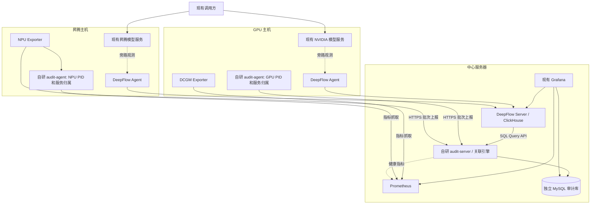

# 异构智算资源无侵入式审计系统 — 开发文档

> 版本：v1.0（一期 PoC 开发基线） | 日期：2026-11-24  
> 适用对象：研发工程师、实施工程师、编码 Agent。文中区分已实现骨架、待实现需求和实机验证事项；编译不等于功能验收。

## 当前开发状态（2026-11-24）

已落地的代码包括 audit-server 的 mTLS 快照接收、主机登记入口、MySQL 迁移/幂等入库；快照原始批次、服务、进程、监听 socket 和设备绑定会在同一事务写入独立事实表。audit-agent 已有 NVIDIA `nvidia-smi` 进程采集、可配置 Ascend Prometheus 指标解析、`/proc` PID/start_ticks/cgroup/netns 读取、Docker/systemd cgroup 归组、磁盘队列、mTLS 上报、ACK 删除、永久拒绝隔离和网络失败指数退避。Agent 会在上报绑定前复核 PID 的 `start_ticks`，并在快照过大时压缩可选数据、裁剪记录且标记采集不完整。

当前仍未完成：监听 socket/IP/端口采集、Docker 元数据查询、进程生命周期时间窗查询、DeepFlow 请求 SQL 轮询与归因、告警规则与通知、Prometheus/Grafana 仪表盘及数据源配置、真实 exporter 指标映射、主机证书/镜像 digest 的正式交付流程。DeepFlow 客户端已支持安全配置下的 SQL POST 和 `SHOW TAGS`/`SHOW METRICS` 字段发现；要实现请求轮询仍需目标 v7.2.4 实例的真实 schema 结果与服务端 PID/IP 方向样例。昇腾模板中的 metric/label 是待现场替换占位符。仓库构建检查尚不能替代 NVIDIA 与 910B 实机联调；开发阶段目标规模仍为各一台服务器。

## 1. 项目目标与边界

对已运行的 Linux 智算服务器进行旁路纳管，覆盖 NVIDIA GPU、华为昇腾 NPU，以及 Docker、systemd 启动的模型/推理服务。不要求业务代码埋点，不改动既有调用链路，不引入强制代理。统一展示设备资源、服务归属、API 请求记录、来源 IP 与历史统计。

一期核心产出是 `来源 IP → API → API 进程 → 服务实例 → 推理进程 → 算力设备` 的可追溯关系。关联是服务级归因，不证明每次请求实际执行了 GPU kernel，更不等于精确的单请求算力、Token 或费用计量。健康检查、模型列表等接口应与推理接口分别统计。

### 1.1 范围

| 需求 | 一期要求 |
|---|---|
| 纳管 | 手动登记主机，支持两类加速器及 x86_64/aarch64 实机适配 |
| 开发联调规模 | NVIDIA 多卡服务器 1 台、昇腾 910B 服务器 1 台；先以小规模服务验证，不以多节点或大规模服务接入作为开发前提 |
| 设备 | 型号、设备标识、利用率、设备内存、健康、功耗/温度（支持时） |
| 服务 | Docker、systemd、独立进程（后者仅在证据充分或配置确认时归组） |
| API | HTTP 请求为首要验收协议；HTTPS/gRPC 按实际版本及运行库验证；不支持协议只展示网络连接级信息 |
| 审计 | 请求时间、观察到的来源 IP、目标服务、方法、路径、状态、耗时、关联设备、关联依据 |
| 界面 | 复用 Grafana，不建设 React 管理门户 |
| 安全 | 默认不存请求/响应正文、凭证、完整查询字符串；访问控制、异常告警、采集健康监控 |

非一期范围：精确请求级算力计费、自动调度/阻断、模型训练监控专用功能、全网原始客户端身份还原、强合规不可抵赖审计、跨容器/跨主机无条件自动归因。无证据的关系必须标记未知，不允许猜测。

## 2. 技术路线与责任边界

| 组件 | 来源 | 在本项目中的职责 | 不负责 |
|---|---|---|---|
| DeepFlow Agent/Server | [DeepFlow CE](https://github.com/deepflowio/deepflow) | eBPF/网络观测、协议解析、原始调用日志、进程相关标签、查询 API | GPU/NPU 进程归因、完整性保证 |
| DCGM Exporter | [NVIDIA 官方](https://github.com/NVIDIA/dcgm-exporter) | NVIDIA 设备遥测，Prometheus 指标 | 默认不能保证输出普通 Docker/systemd 的宿主机 PID 映射 |
| NPU Exporter | [Ascend mind-cluster](https://github.com/Ascend/mind-cluster/tree/master/component/npu-exporter) | 昇腾设备遥测及支持时的进程指标 | 网络请求来源、业务归因 |
| Prometheus | [官方仓库](https://github.com/prometheus/prometheus) | 双 Exporter 和自研组件健康指标抓取、时序存储 | 请求明细及历史服务关系数据库 |
| Grafana | [官方仓库](https://github.com/grafana/grafana) | 仪表盘、多数据源查询、基础告警 | 跨数据源自动准确关联 |
| ClickHouse | DeepFlow 配套 | 原始 L7 观测日志存储 | 本项目不直接修改其内部表 |
| MySQL 8 | [官方仓库](https://github.com/mysql/mysql-server) | 一期独立业务库：主机、关系、审计结果、游标 | 大规模长期原始流量留存 |
| go-nvml | [官方仓库](https://github.com/NVIDIA/go-nvml) | 后续稳定版可选：GPU PID 查询 | 网络观测 |
| audit-agent | **自研 Go** | PID 补充采集、服务发现、主机身份、可靠上报 | 不写 eBPF、不重复设备级遥测 |
| audit-server | **自研 Go** | DeepFlow 查询适配、历史关联、去重、审计规则与存储 | 不替代 DeepFlow、Prometheus |
| dashboards/deploy | **自研配置** | Grafana provisioning、部署、离线交付、验收脚本 | 不 Fork 三大基础项目 |

选型：Go（Agent/Server 两个可执行文件），MySQL 8（独立实例或隔离业务库），标准 HTTP JSON API，Prometheus exposition，Grafana 复用 DeepFlow 配套实例。PoC 使用 nvidia-smi 子进程作为 NVIDIA PID 采集器，NVML 为可替换适配器，避免 CGO/驱动库跨架构交付阻塞。Prometheus 为硬件指标唯一权威来源，Remote Write 至 DeepFlow 是可选扩展，不列入一期必需链路。

### 2.1 版本基线

| 组件 | 开发/PoC 基线 | 约束 |
|---|---|---|
| DeepFlow Server / Agent / App | v7.2.4 | 三者保持同一发布版本；镜像锁定 digest |
| NVIDIA Driver | 保持现网版本 | 按 DCGM 支持矩阵验证，不为本项目擅自升级 |
| NVIDIA DCGM / DCGM Exporter | 优先 DCGM 4.6.1 / Exporter 4.8.4 | 使用官方配套组合；旧驱动环境按已验证配套版本向下适配 |
| Ascend Driver / Firmware | 保持现网版本 | 不为本项目擅自升级 |
| Ascend NPU Exporter | 按 HDK 配套矩阵选择 | 在 910B 实机确认指标、PID 标签及宿主 PID 映射 |
| Prometheus | 3.13.5（3.13 LTS） | 开发部署前锁定镜像 digest；若版本更新，保持在受支持的 LTS 补丁线 |
| Grafana / ClickHouse | DeepFlow 官方部署配套版本 | 跟随 DeepFlow v7.2.4 部署包并核验组件版本 |
| MySQL | 开发/PoC 使用本机已有 8.0.46 镜像；生产目标为 8.4 LTS | 8.0.46 是已 EOL 的开发基线；生产升级前在 8.4 LTS 验证迁移和查询（[官方生命周期说明](https://dev.mysql.com/doc/relnotes/mysql/8.0/en/)） |
| audit-agent / audit-server | Go | 版本、构建产物校验和及依赖清单随交付记录 |

正式部署镜像必须锁定具体版本及 SHA256 digest，不使用 `latest` 或浮动的 `stable` 标签。开发机可复用本机 `mysql:8.0.46` 镜像，但审计库必须运行在专用 Compose 项目、独立容器、独立数据库和独立数据卷中，仅接入本项目内部 Docker 网络，不发布宿主机 3306。现有业务 MySQL 及其数据卷属于只读保护范围：不得连接用于本项目、停止、重建、升级、迁移、挂载其数据目录或执行清理操作；严禁对其执行删除数据库/表、重置数据目录、`docker compose down -v` 或全局 volume prune。

## 3. 总体架构



运行关系：Agent 与 Exporter 并行部署；中心端按请求结束时间拉取 DeepFlow 日志，按请求开始时间匹配历史服务关系。Grafana 查询 MySQL 中已经关联好的记录，不将 Grafana Transform 当作核心关联引擎。

## 4. 工程目录与交付物

```text
compute-resource-audit/
├── cmd/audit-agent/main.go
├── cmd/audit-server/main.go
├── internal/
│   ├── contract/               # DTO、枚举、校验、版本
│   ├── agent/
│   │   ├── collector/nvidia/   # nvidia-smi / NVML adapter
│   │   ├── collector/ascend/   # NPU metrics parser
│   │   ├── procfs/             # PID、start_ticks、netns、cgroup
│   │   ├── discovery/          # docker / systemd / socket
│   │   └── spool/              # 本地可靠队列
│   ├── deepflow/               # schema discovery, SQL client, normalization
│   ├── correlation/            # 时态关系、归因、去重
│   ├── ingest/                 # 批次接收和幂等
│   ├── store/                  # repository / migration
│   ├── rules/                  # IP CIDR、接口分类、告警
│   └── telemetry/              # 自监控
├── migrations/                # MySQL 版本迁移
├── configs/                   # agent/server 示例、schema profiles
├── dashboards/                # JSON + provisioning YAML
├── deploy/                    # Compose、systemd、Prometheus、安装脚本
├── tests/fixtures/            # 脱敏的真实指标和日志样本
├── docs/
├── Makefile
├── go.mod
└── README.md
```

所有第三方版本固定到经过验证的 tag/镜像 digest；记录软件许可证、SBOM 与来源。自研接口与数据库迁移版本化。禁止把密钥、业务请求正文、内网真实配置提交到 Git。

## 5. 自研模块一：audit-agent

### 5.1 采集流程

每 10 秒进行一次采样（可配置，昇腾应匹配 Exporter 内部刷新周期）：读取 boot_id → 获取设备 PID 快照 → 采集进程及其服务归属 → 枚举服务监听端口及 namespace → 形成批次 → 先落盘再上报 → ACK 后删除。单个采集器失败不影响其他采集器；部分失败标记 `partial`，不能当作空设备列表。

| 数据 | 实现要求 |
|---|---|
| GPU PID | 运行 `nvidia-smi --query-compute-apps=gpu_uuid,pid,used_gpu_memory --format=csv,noheader,nounits`；限制执行时间，CSV 解析，不用 shell 拼接；后续 go-nvml 查询计算进程 |
| NPU PID | GET 本地 `/metrics`，使用 Prometheus expfmt 解析；根据实机样本识别 `npu_chip_info_process_info` 的 PID、设备标签、内存单位；标签不写死，建立按版本的映射配置 |
| 主机 | 安装时分配固定 host_id，读取 boot_id；不能用 IP 或 hostname 单独作主键 |
| 进程 | `/proc/<pid>/stat` 第22字段 starttime（clock ticks），正确处理括号中的 comm；PPID、cgroup、namespace；读取前后校验进程未被替换 |
| Docker | cgroup v1/v2 路径解析、完整 container ID，按需通过 Docker API 查询名称、镜像、端口映射；不读取 Env，不执行容器命令 |
| systemd | cgroup 路径及 systemd D-Bus `GetUnitByPID` 或等价查询，提取 unit/control group；区分 docker scope 和宿主服务 |
| socket | `ss -lntp` 作为诊断；实现可用 procfs/inet_diag 关联 socket inode、监听 IP/端口、netns，处理容器 bridge 和 published port |

禁止把容器的 GPU 可见配置（如 CUDA_VISIBLE_DEVICES）直接当作实际设备占用。NPU 需区分卡、芯片、逻辑设备/vNPU；UUID 缺失时采用 host_id + 厂商 + 已核验物理/逻辑标识。设备内存转换为 byte 前必须确认厂商指标单位。不得把不支持的值填成 0。

### 5.2 Go 接口（设计契约）

```go
// types omitted: each sample includes observed time, source and status.
type AcceleratorCollector interface {
    Collect(ctx context.Context) (DeviceProcessSnapshot, error)
}
type ServiceResolver interface {
    Resolve(ctx context.Context, p ProcessIdentity) (ServiceIdentity, error)
}
type SnapshotReporter interface {
    Report(ctx context.Context, batch SnapshotBatch) (Ack, error)
}
```

Agent 仅持有本主机事实，不尝试推断跨主机调用。Docker 与 systemd 关系识别优先使用 cgroup 证据；API 与 worker 同服务组可建立服务级关系，但一个容器中多模型不能自动拆分。对独立进程只有明确父子生命周期/配置关系才归组。

### 5.3 上报协议

`POST /api/v1/agent/snapshots`，HTTPS，按 host_id 分配凭证，强制 mTLS；客户端证书 Subject Common Name 必须与已登记的 `host_id` 一致。请求头 `Idempotency-Key` 必须等于 `batch_id`。服务端限制请求体（默认 2 MiB）并校验枚举；观察时间超前服务端 2 秒以上时记录告警指标但仍保留批次，迟到批次按摄取延迟处理。只有事务提交后才返回 ACK。同一 host/batch ID 内容哈希相同则返回相同 ACK，内容不同返回冲突。

```json
{
  "schema_version": 1,
  "batch_id": "gpu01-bootA-000123",
  "host_id": "gpu01",
  "boot_id": "bootA",
  "observed_at": "2026-11-24T06:00:00Z",
  "sequence": 123,
  "status": {"nvidia": "ok", "ascend": "not_applicable", "process": "ok"},
  "processes": [
    {"pid": 12340, "start_ticks": 10901, "service_instance_id": "docker:abc", "netns": "4026532001"},
    {"pid": 12345, "start_ticks": 10912, "service_instance_id": "docker:abc", "netns": "4026532001"}
  ],
  "services": [{"id": "docker:abc", "type": "docker", "name": "qwen", "listen": [{"pid": 12340, "ip": "0.0.0.0", "port": 8000, "netns": "4026532001"}]}],
  "bindings": [{"device_key": "nvidia:GPU-example", "pid": 12345, "start_ticks": 10912, "memory_bytes": 8589934592}]
}
```

示例 ID 为简写，真实 container ID、boot_id 使用完整标识。所有时间 UTC；`observed_at` 必须反映真实采样时间，若 NPU 数据来自缓存则记录源刷新时间或标记 `source_time_unknown`。返回 `200 {"batch_id":"...","accepted":true}`，重复批次返回相同 ACK；4xx 非重试错误进隔离队列，429/5xx/网络错误指数退避。默认磁盘队列上限 512 MiB，满时告警、记录缺口，不静默删除。ACK 仅在中心端事务提交后返回。

## 6. 自研模块二：audit-server

### 6.1 DeepFlow 查询适配

调用官方 SQL Query API（`POST /v1/query/`，表 `flow_log.l7_flow_log`）。先在真实 CE 版本执行 `SHOW TAGS FROM l7_flow_log` / `SHOW METRICS FROM l7_flow_log` 或版本支持的 schema 查询，并保存字段能力清单。不能把下表中的逻辑名直接假定为物理 SQL 字段。

| 归一化字段 | DeepFlow 候选字段或证据 |
|---|---|
| raw_event_id | `_id`，按字符串保存，避免 64 位精度丢失 |
| request_start/end | `start_time`/`end_time`（通常微秒）；`time` 为秒级时间桶 |
| source_ip/destination_ip | `ip_0`/`ip_1` 等方向字段，按实际 schema 验证 |
| server_pid | `process_id_1` 等服务端 PID；必须确认其属于观测节点 |
| global_process | `gprocess` 相关字段，不直接等同宿主 PID |
| agent_id | `agent`/`agent_id` 等实际标签，结合登记映射与观测位置 |
| method/path | `request_type`、`request_resource`、`endpoint` |
| status/duration | `response_code`、`response_duration`（通常微秒，转毫秒） |
| observation | `observation_point`、`signal_source`、`flow_id`、日志类型 |

按固定版本构建字段白名单，不 SELECT * 持久化。禁止把响应正文、敏感 header、query 参数写入审计库。原始 DeepFlow 本身的字段采集/留存策略也必须由实施方检查，限制访问；无法满足数据安全要求时暂停接入该协议。HTTPS 只有可解析时才记录 Path。

拉取策略：以结束时间分窗（默认每 10 秒查询已结束的窗口，延迟 30 秒、重叠 120 秒，实测调整）；按 `time` 和唯一 ID 稳定排序，分页必须覆盖整个窗口，不能单用 LIMIT 丢尾部。若查询 API 不支持键集分页，使用缩小时间窗口加稳定分页并检测上限；未完整拉取不得推进游标。处理迟到数据、长 SSE 调用（开始时间关联，结束时间摄取）；查询失败保留游标、重试并告警。

### 6.2 时态关联算法

1. 只选择已验证的服务端观测点及正确方向，避免客户端和服务端重复计数；保留原始观测 ID。
2. 通过有效期内 DeepFlow agent_id 与 host_id 登记映射定位宿主机。PID 必须确认属于该宿主机及 namespace。
3. 按请求开始时间查询 `(host_id, boot_id, pid, start_ticks)` 的历史关系。首选进程精确匹配；其次同一服务实例/cgroup；端口+地址+namespace 唯一匹配只作为较低置信证据。
4. 关联该服务在对应时刻有证据支持的设备集合。若请求跨越服务设备变化，标记关系变化；不推断具体使用哪张卡。
5. 跨容器 API/worker 必须有人工配置（有效期与变更记录）或可验证链路；只共享主机、GPU 或时间不能成为归因证据。
6. 无法关联的记录保留并标记原因；已有健康采样证明对应服务没有设备占用时也只标记 `no_observed_binding`，不能宣称从未使用算力。
7. 对迟到的 Agent 批次进行有界重算，更新关联版本并保留变更理由。报告按请求记录计数，不能按设备关联行计数。

```text
resolve(event):
    host = resolve_observer_and_server_host(event)
    if host is ambiguous: return unknown("host_ambiguous")
    service = resolve_service_at(host, event.pid, event.start, event.socket)
    if service is ambiguous: return unknown("service_ambiguous")
    bindings = active_bindings_at(service, event.start)
    if bindings are stale or source failed: return unknown("snapshot_stale")
    if bindings empty: return no_observed_binding
    return attributed(service, unique(bindings.devices), evidence)
```

置信度：`observed_process`（请求进程本身有设备绑定）、`service_group`（同容器或 unit）、`configured_relation`（经确认的跨服务关系）、`port_inferred`（唯一端口映射）、`unknown`。全部都是服务或进程级归因，不是 GPU kernel 级证明。设备指标仅作同期上下文：取请求时间附近有效样本，展示样本时间与延迟，不把设备利用率归给请求。

### 6.3 生命周期与去重

快照是离散观测，不是真实起止事件。关系表存 `first_seen/last_seen`、推定有效区间、证据来源和新鲜度；连续两次完整采样均缺失可关闭关系（阈值可配置），但不能回填精确退出时刻。默认新鲜度为有效采集周期的 3 倍，超期置 stale；中间采集失败不得自动关闭关系。boot_id 变化关闭旧生命周期；容器重启以进程实例区分，systemd 重启以 invocation ID（可获得时）区分。

同一原始行以 DeepFlow 实例 ID + tenant + raw_event_id 幂等。跨观测点重复只在已验证的服务端规则或明确协议请求标识下合并；不能单靠 IP+路径+时间粗粒度合并，否则会吞掉并发合法请求。保存重复来源和去重规则版本。

### 6.4 来源 IP 与规则

保存 `observed_src_ip` 与 `effective_src_ip`（后者仅在可信代理或经过验证的日志关联时赋值）。不能直接信任任意 X-Forwarded-For。保留来源类型、证据与代理链可见性。CIDR 白名单以确认的有效 IP 或明确配置的观察 IP 执行；未知来源触发待确认告警，不自动阻断。

接口分类：`inference`（配置确认的推理路径）、`management`、`health`、`unknown`。相同服务的所有接口均可展示，但推理量统计按分类过滤；URL path 清洗、长度限制、敏感路径脱敏。

## 7. 数据模型

采用 MySQL 8，所有时间 DATETIME(6) UTC，IP 用 VARBINARY(16) 或规范化字符串，64 位观测 ID 用 VARCHAR，关系有效期采用左闭右开。当前已迁移的表标为“已实现”；历史有效区间、请求归因等表仍是后续建表契约。禁止在 DeepFlow 内部库建业务表。

| 表 | 关键字段、约束与索引 |
|---|---|
| hosts | host_id PK、hostname、management_ip、arch、vendor、last_seen、status |
| observer_bindings | deepflow_instance、agent_id、host_id、valid_from/to；索引 agent_id+时间 |
| snapshot_batches | host_id、batch_id 唯一、boot_id、sequence、observed_at、status、payload_sha256、payload JSON；批次幂等，payload 仅含主机进程/服务/设备事实 |
| snapshot_services / snapshot_processes / snapshot_listeners / snapshot_device_bindings | 每个快照中的服务、PID 生命周期标识、监听和设备绑定；外键关联该批次；与 `snapshot_batches` 同事务写入（已实现） |
| devices | device_key PK（含 host_id）、vendor、model、uuid/physical_id、logical_id |
| process_instances | process_key PK、host_id、boot_id、pid、start_ticks，组合唯一；first/last_seen |
| service_instances | service_id PK（含主机及实例生命周期）、type、name、container_id、unit、first/last_seen |
| process_service_history | process_key、service_id、valid_from/to、evidence、last_seen；索引 process_key+时间 |
| service_socket_history | service_id、netns、ip、port、process_key、valid_from/to；索引 host+port+时间 |
| device_binding_history | device_key、process_key、first_seen、last_seen、valid_from/to、confidence、status |
| service_relations | API service_id、worker service_id、valid_from/to、approved_by、evidence |
| audit_events | event_id PK、raw_event_id、observer_id、start/end、source/destination、path、method、status、duration_ms、service_id、attribution_status、confidence、rule_version；源 ID 组合唯一；索引 time+service、time+IP、time+status |
| audit_event_devices | event_id、device_key、evidence、relation_version，组合唯一；索引 device_key+event_id |
| ingest_cursors | source_id PK、complete_until、last_success、error |
| audit_rules | rule_id、service scope、CIDR、path patterns、version、enabled |
| audit_alerts | alert_id、rule_id、event_id、severity、status、created_at、dedup_key |

事务：批次落库与关系更新同事务；日志入库、设备关联行和游标提交同事务或使用持久化窗口任务状态确保可重放。查询按时间范围分页，禁止不带时间范围全表扫描。PoC 保留 7 天明细、30 天关系（需覆盖审计重算周期）；正式容量根据实际流量测量，必要时将明细迁移至独立 ClickHouse。删除任务须按审批策略执行；不得自动删除未过留存期记录。

## 8. 自研接口与 Grafana 配置

| 接口 | 方法 | 职责 |
|---|---|---|
| /api/v1/agent/snapshots | POST | 认证、批次持久化、幂等 ACK |
| /healthz | GET | 进程存活 |
| /readyz | GET | 数据库、迁移及必要依赖就绪 |
| /metrics | GET | 内部采集健康和延迟指标 |

一期不需要对外 CRUD 平台；主机登记、白名单、服务关系用版本控制的受控配置和迁移工具初始化；严禁配置覆盖历史关联。后续按需开放查询与管理 API。

Grafana 使用三个数据源：现有 DeepFlow（原始调用诊断）、Prometheus（设备指标）、独立 MySQL 只读账号（关联审计）。仪表盘 JSON 以稳定 datasource UID 引用，统一变量 host/vendor/service/time/source_ip，所有查询限制时间范围并安全转义。Grafana 不直接跨源 Join 来计算核心审计结论。

| Dashboard | 关键展示 |
|---|---|
| 资源总览 | 在线主机、设备数、NVIDIA 与昇腾各自利用率（指标语义不同，不求简单总平均） |
| 设备详情 | 利用率、内存、温度、功耗、关联服务、采样新鲜度 |
| 服务清单 | Docker/systemd、监听端口、API/worker PID、设备集合、关系置信度 |
| 调用明细 | 时间、来源 IP 类型、方法、路径、状态、耗时、服务、设备、归因原因 |
| IP 分析 | 按请求去重后的来源排行、趋势、未知来源/异常 IP |
| 采集健康 | Agent 心跳、Exporter up、日志摄取滞后、未关联比例、队列及丢失 |

审计计数示例（Grafana MySQL 查询，依实际表字段完成）：

```sql
SELECT observed_src_ip, COUNT(*) AS calls
FROM audit_events
WHERE $__timeFilter(request_start)
  AND attribution_status = 'attributed'
GROUP BY observed_src_ip ORDER BY calls DESC LIMIT 20;
```

实际迁移统一使用 `request_start`、`request_end`、`observed_src_ip` 命名。设备维度查询必须按 event_id 去重，多卡请求不能重复计入总量。告警阈值配置初值：Agent 超过 3 个周期未上报、Exporter 连续 1 分钟 down、摄取滞后超过 2 分钟、存在队列缺口或明确白名单违规；实际值按基线调整。

## 9. 安全与可靠性

- 新增组件仅旁路、只读采集，不重启现有推理服务，不修改驱动、不改变网络路由。eBPF/驱动访问的权限单独审批；Docker socket 即使只读挂载也具有高权限风险，优先 procfs/cgroup，必要时使用受限代理。
- Agent→Server 使用 TLS/mTLS、逐主机凭证；Exporter、数据库、DeepFlow API 不对公网开放。Grafana 最小权限和只读账号；普通审计员不能访问原始敏感日志。
- 自监控指标：snapshot_age、spool_bytes、upload_failures、ingest_lag、query_errors、unattributed_ratio、dedup_count、source_drop_detected。高基数 PID/请求 ID 不作为自监控指标标签。
- DeepFlow 可能采样、限流、丢事件；不能宣称零丢失。必须记录可观测缺口、配置与版本；同步主机时钟，默认偏差超 2 秒告警。
- PoC 不满足强合规防篡改要求。生产升级追加不可变归档、审计员操作记录、备份恢复、日志留存审批和容量/故障测试。

## 10. 开发任务与验收 Gate

| 编号 | 任务 / 产出 | 前置 | 估算人日 |
|---|---|---|---:|
| D01 | DeepFlow CE、双 Exporter 实机 PoC，保存脱敏 schema 和指标样本 | 两类测试主机 | 1–2 |
| D02 | DTO、数据库迁移、配置契约、主机登记 | D01 | 0.5–1 |
| D03 | audit-agent GPU/NPU PID、procfs、Docker/systemd、批次上报 | D01/D02 | 1–2 |
| D04 | audit-server 查询、历史关联、幂等、未关联分类 | D02/D03 | 1–2 |
| D05 | Grafana 预置仪表盘及自监控 | D04 | 0.5–1 |
| D06 | 双硬件联调、重启/断网/重复测试、部署与回滚材料 | D03–D05 | 1–2 |

合计约 5–10 人日的核心 PoC 粗估，不包括硬件驱动整改、特殊协议支持与完整生产强化；估算以一台 NVIDIA 多卡主机和一台昇腾 910B 主机的小规模联调为范围。

### 10.1 必须通过的验收用例

| ID | 场景 | 预期结果 |
|---|---|---|
| T01 | NVIDIA Docker 推理、已知来源 IP、N 次测试请求 | 路径/IP/服务及正确设备可见，记录覆盖率可测 |
| T02 | 昇腾 systemd 推理 | 宿主 PID 与真实 NPU 绑定一致 |
| T03 | API PID 与 worker PID 不同、同一容器/unit | 服务级关联，标明 evidence |
| T04 | 同一服务多卡、多个服务共享一张卡 | 多对多关系正确；总请求数不重复 |
| T05 | 容器重启、PID 复用、服务器重启 | 旧日志仍指向旧实例，不关联新进程 |
| T06 | 普通 CPU 服务、未识别服务、健康接口 | 分别展示已知无观测绑定、未知、非推理分类 |
| T07 | Nginx/NAT/HTTPS/SSE | 明确展示可见来源与协议限制，不伪造 IP 或 path |
| T08 | Exporter 停止、Agent 断网、日志查询失败 | 告警、缓存补传、游标不丢失、关系 stale |
| T09 | 重放同一批次和日志窗口、并发相同路径请求 | 重放不重复，真实并发不误合并 |
| T10 | 访问控制、敏感参数、超大上报 | 非授权拒绝，无敏感正文进入业务审计库 |

PoC 目标：在受控、可解析 HTTP 环境下，对每类硬件至少执行 100 次可独立计数的请求；目标可见率 ≥95%、已关联记录设备/服务正确率 100%、未确认记录均有原因；单独记录丢失率、重复率、关联覆盖率，禁止仅用已关联样本掩盖遗漏。端到端延迟目标 P95 ≤120s（不含未结束的长流式请求）；通过对照无 Agent 的业务基线评估 P95 延迟和宿主开销，不预先宣称零影响。指标为拟定验收目标，需实测批准。

开发 Gate：D01 未确认 DeepFlow 服务端 PID 或昇腾宿主 PID 时，不进入自动精确关联开发；允许先交付端口低置信方案，但必须在界面明确标注。所有单元、集成测试及部署验收通过方可进入生产试点。

## 11. 官方资料与版本核验

- DeepFlow CE：[代码](https://github.com/deepflowio/deepflow)、[SQL Query API](https://get.deepflow.io/docs/integration/output/query/sql/)、[请求日志字段](https://demo.deepflow.yunshan.net/help/features/universal-map/request-log/)、[Agent 配置](https://demo.deepflow.yunshan.net/help/configuration/agent/)。
- NVIDIA：[DCGM Exporter 文档](https://docs.nvidia.com/datacenter/dcgm/latest/gpu-telemetry/dcgm-exporter.html)、[go-nvml](https://github.com/NVIDIA/go-nvml)。
- 昇腾：[NPU Exporter 指标](https://github.com/Ascend/mind-cluster/blob/master/docs/zh/scheduling/06_api/00_npu_exporter/01_prometheus_metrics_api.md)、[安装说明](https://github.com/Ascend/mind-cluster/blob/master/docs/zh/scheduling/05_developer_guide/00_installation_deployment/00_manual_installation/03_npu_exporter.md)。
- [Prometheus](https://prometheus.io/docs/prometheus/latest/configuration/configuration/)、[Grafana 数据源](https://grafana.com/docs/grafana/latest/datasources/)。

资料核对日期：2026-11-24。以实际锁定版本、真实主机样本和配套部署文档为准；本文所列自研接口、表结构和默认值是研发合同，不是已经存在的上游功能。
